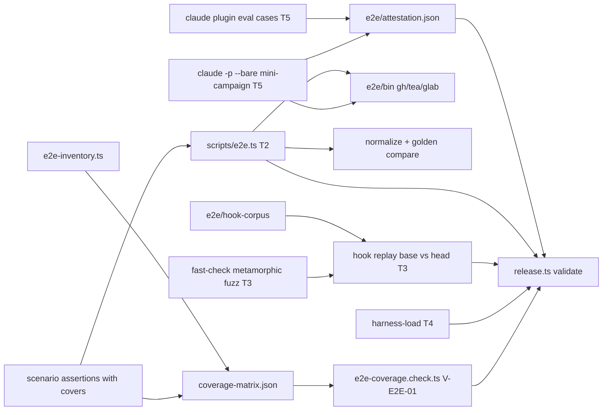

# ADR-053 — Behaviour e2e suite and release gate

> **Accepted** 2026-11-17 by the owner (design track, issue #1244). Reconciled with
> `research-plugin-e2e-testing.md`, whose tier numbering T0–T5 this ADR uses.

## Requirements Framing

Owner request and rulings (2026-11-17):

- Ship a behaviour e2e suite so the plugin's behaviour cannot regress.
- **Full coverage**: every agent role and decision point, V-code, hook pattern, script, harness
  target (Claude, Cursor, Codex, Antigravity) and user-visible behaviour maps to a test, and a
  verify check fails on an unmapped one.
- The live agent tier **gates the release** once the suite ships.
- **Sequencing**: the suite is **not** in the upcoming release. It is the theme of the release
  after that, and the gate takes effect from that release.

Measured at `2c590fc6`: 8 agent roles, 137 V-code rows, 45 hook pattern ids (19 bash, 26 file),
50 script entrypoints, 64 checks, 213 test files (about 8,300 lines of hook tests), 4 build
targets, 20 recorded hook events. No script invokes `claude -p` today.

**Already scripts** (deterministic, testable with no model): forge-sync, worker-return
validation (`validate-worker-json.ts`, SubagentStop hooks), `review-aggregate.ts`,
`design-aggregate.ts`, `plan-quality-gate.ts`, stacking (`stack-check.ts`, `stack-parent.ts`,
`stack-repair.ts`, `lib/stack-*`), merge order and gate (`lib/merge-next.ts`, `lib/merge-gate/*`),
CI diagnosis (`ci-diagnosis.ts`, `ci-verdict.ts`, `trunk-red.ts`), `campaign-record.ts` (owner
decisions, sleep park/resolve), `lib/state-write-guard.ts`, `carry-staged-artifacts.ts`,
`campaign-status.ts`, pacing, recovery, and every PreToolUse/SubagentStop hook.

**Only in agent prose** (testable only live): router classification, planning, implementation,
reviewer judgment (most `reviewer.md` V-codes), the orchestrator's phase sequencing and the
decision to mutate `queue.json`, clarify and split gates, the coordinator's spawn loop.

## Options + Trade-off Matrix

**D1 — Where the fake forge plugs in.**

| Option | Serves T2 scripts | Serves T5 live agents | Fidelity | Effort |
|---|---|---|---|---|
| A. In-process `ForgeAdapter` fake (extend `campaign-status/forge-fake.ts`) | Only scripts taking an injected adapter | No: agent prose calls `gh` directly | Skips argv building and parsing, where #1240 lived | Low |
| **B. PATH shim `e2e/bin/{gh,tea,glab}` → one Bun fake-forge CLI over a JSON state file** | Yes, scripts run unmodified as subprocesses | Yes, same binaries on the agent's PATH | Exercises the real adapter argv and parsing | Medium |
| C. Local Gitea container | Yes | Yes | Real for Gitea only | High; Docker in CI |

**Chosen: B.** The adapter's only spawn sites call bare `gh`/`tea`/`glab`
(`scripts/lib/forge-adapter/cli.ts:15`, `tea-cli.ts:8`, `glab-cli.ts:8`), so a PATH prefix
intercepts every forge call with no production change. An unscripted argv exits 97 and is
recorded; a scenario that triggers one fails. C stays the option for the drift contract test
(§ Risks).

**D2 — Scenario format.**

| Option | Reviewability | Drift detection | Effort |
|---|---|---|---|
| A. A TypeScript test per scenario | Low | Ad hoc | Low |
| **B. Declarative `scenario.json` + seed + normalized goldens, one runner** | High | Golden diff names file and field | Medium |
| C. `toMatchSnapshot` | Medium | Opaque `.snap` | Low |

**Chosen: B.**

```
e2e/scenarios/<id>/
  scenario.json   # steps and assertions
  seed/           # .blackhole/*, forge.json (fake forge state), repo files
  golden/         # queue.json, findings-ledger.json, status datasets, forge-writes.jsonl, hook-events.jsonl
```

```json
{
  "id": "stacked-chain-squash-parent",
  "forge": "github",
  "steps": [
    { "run": "forge-sync" },
    { "worker": "implementer", "return": "returns/implementer-pr-101.json" },
    { "run": "stack-check", "args": ["--pr", "102"] },
    { "forge_event": "merge", "pr": 101, "method": "squash" },
    { "run": "stack-repair", "args": ["--pr", "102"] }
  ],
  "assert": [
    { "golden": "queue.json", "covers": ["transition:in-flight/review->merged"] },
    { "expect": { "forge_write": "pr-retarget", "pr": 102, "base": "main" },
      "covers": ["behaviour:stacking.parent-landed", "script:stack-repair"] },
    { "expect": { "exit": 1, "step": "stack-check", "stderr_has": "V-STACK-02" },
      "covers": ["vcode:V-STACK-02#trigger"] }
  ]
}
```

`covers` tags sit **on an assertion**, never on the scenario. `run` executes
`bun run scripts/<name>.ts` in a throwaway repo with `e2e/bin` first on PATH; `worker` pipes a
scripted return through `validate-worker-json.ts` and the documented apply path; `hook` feeds a
hook its stdin JSON; `forge_event` mutates the fake forge as a human would. Goldens are
normalized (timestamps → `<ts>`, SHAs → `<sha:N>`, temp paths → `<repo>`).

**Golden update**: `bun run e2e --update <id>` rewrites that scenario's goldens; CI only
compares. A golden change ships in the PR with a one-line reason per scenario in the PR body
(`Golden: <id> — <reason>`); a check refuses a golden diff without one, and refuses goldens
that contain un-normalized timestamps, SHAs or absolute paths.

**D3 — Live tier (T5).**

| Option | Covers | Determinism | Cost | Fit |
|---|---|---|---|---|
| A. Only a home-grown `claude -p` campaign | Whole chain | Low | One campaign per trial | No per-agent signal, no baseline |
| B. Only `claude plugin eval` | Per-agent and skill behaviour, with a no-plugin baseline | Medium | Doubles runs for the baseline arm | Cannot drive a multi-agent campaign against a forge |
| **C. `claude plugin eval` per agent + one sandboxed `claude -p --bare` mini-campaign** | Both | Medium | Capped by `--max-cost-usd` | Each part does what it is built for |

**Chosen: C.** The mini-campaign runs `claude -p --bare --plugin-dir <built> --model <pinned>`
in a fresh temp repo whose origin, a github.com URL, is rewritten by `insteadOf` to a local bare
repo, with the stateful fake forge on PATH. It is graded on **outcomes**; the only trajectory
assertions are must-hold safety invariants (no write outside the worktree, no push to `main`, no
merge of a red PR, no unexpected hook deny, no unscripted forge call). A throwaway GitHub repo
was rejected: repo-create token, Actions minutes, cleanup that leaks on crash, and GraphQL is
blocked from cloud sessions.

**D4 — Hook tier (T3).**

| Option | Catches false denies | Catches bypasses | Cost |
|---|---|---|---|
| A. More hand-written unit cases | Only foreseen ones | Only foreseen ones | Low |
| **B. Real-call replay with a base/head verdict diff + fast-check metamorphic fuzz** | Yes: real worker calls | Yes: generated rewordings | Medium |

**Chosen: B.** The corpus is mined from `.blackhole/hook-events/` and its archive, plus session
transcripts (`Bash`/`Write`/`Edit` `tool_use` inputs), scrubbed of secrets and home paths, and
committed. Each record is replayed against the hook at the PR's base and head; **any verdict
change fails** unless the PR body lists it (`Hook-verdict: <record-id> <old>→<new> — <reason>`).
The fuzz generates denied commands under wrappers (`env`, `command`, `nohup`, `sudo -u`),
subshells, brace groups, `eval`, re-quoting, redirects and `cd` chains, and asserts that
rewording a denied command never gets it allowed and that a benign command stays allowed. Known
accepted residuals (`xargs -I{}`, `find -exec`) are fixtures marked `expected: allow-knowingly`.

## Adversarial Evaluation

The two blind critic runs were not executed (no agent tool in this spawn) and
`design-aggregate.ts` was not invoked (`autonomy.design_autonomy` unset); the verdict is
`blocked` either way. Counter-cases argued here:

- **"A fake forge only proves the fake."** Answered by the contract test in § Risks.
- **"Full V-code coverage is unaffordable."** Judgment-only codes are covered at T5 by
  `claude plugin eval` cases; deterministic ones cost seconds. The cost is capped and off the
  per-PR path.
- **"Live runs will flake and block releases."** Answered by a stated k and flake budget (§ Gate),
  never silent retries.
- **"Tags will be added to make the matrix green."** Answered by tag-on-assertion plus the
  falsifiability pass (§ Component Decomposition).

## Component Decomposition



### Coverage: a units × tiers matrix, reported per row

`scripts/e2e-inventory.ts` enumerates units from their sources of truth; nothing is
hand-listed. The coverage report prints one line per row (unit kind × tier) with covered/total
and the uncovered ids, and **never a single overall percentage**. Live rows report pass^k with
their k, never folded into a deterministic figure.

| Unit | Source of truth | Covered when | Tier |
|---|---|---|---|
| V-code | `src/references/blackhole-vcodes.md` rows, expanded (`V-SEC-01/02` → two) | One **trigger** case raises it and one **near-miss** case does not | T0/T2 for script-enforced, T3 for hook codes, T5 for reviewer judgment |
| Hook pattern | `templates/hooks/pretooluse/patterns/*.json` ids + guard modules + fail-open path | One **deny** case and one **allow** near-miss | T3 |
| Agent decision point | per-role `status` enums in `worker-schemas.md` + route flags | Each (role, status) consumed by a scripted return; each agent has ≥ 1 live case | T2 + T5 |
| Queue transition | `QUEUE_STATUSES`/`QUEUE_PHASES` (`scripts/lib/campaign-status/queue.ts`) and their legal edges | **Every legal edge taken** in a scenario; illegal edges rejected by the write guard | T2 (edge log + fast-check model-based sequences) |
| Script entrypoint | non-test `scripts/*.ts` | Spawned at least once | T2 (spawn log) |
| Harness target | `COMMITTED_TARGET_TREES` | Tree loads and its agents, skills, hooks resolve; Claude also in T5 | T4 + T5 |
| User-visible behaviour | new `e2e/behaviours.md` catalog | One T2 scenario; safety-critical ones also a T5 case | T2 + T5 |

**Anti-gaming.** A `covers` tag counts only when attached to an assertion with a concrete
expected value. `bun run e2e --prove-falsifiable` inverts each tagged assertion's expectation and
requires the scenario to fail; a tag whose assertion still passes is reported unbacked. A
`#trigger` tag counts only if the same unit also has a `#near-miss` tag with the opposite
expectation.

`scripts/checks/e2e-coverage.check.ts` (new **V-E2E-01, BLOCK**) fails on an unmapped unit, a
dangling tag, an unbacked tag, or a ratchet baseline (`e2e/coverage-baseline.json`) that grew.
The baseline may only shrink; the release gate requires it empty.

## Design Principles Validation

| Axis | Score | Note |
|---|---|---|
| SRP | ✓ | Inventory, coverage check, runner, fake forge, hook replay, fuzz, load check, live runner and gate are separate units |
| DIP | ✓ | No production change; the seam is PATH |
| DRY | ~ | Two forge fakes coexist (in-process for unit tests, CLI for scenarios); they share recorded fixtures |
| KISS | ✓ | JSON scenarios, one runner, no Docker on the per-PR path |
| YAGNI | ~ | Cursor/Codex/Antigravity live runs deferred; T4 covers their loading |
| Pattern | ✓ | Ratchet baseline mirrors `coverage-regression.check.ts` and `CONTENT_GATE_GRANDFATHERED` |

## Refactoring Impact Analysis

| Consumer | Classification | Note |
|---|---|---|
| `scripts/lib/forge-adapter/cli.ts:15`, `tea-cli.ts:8`, `glab-cli.ts:8` | TRANSPARENT | Bare-name spawn; the shim intercepts |
| `scripts/lib/campaign-status/forge-fake.ts` | TRANSPARENT | Kept for unit tests |
| `templates/hooks/pretooluse/validate-*.js` | TRANSPARENT | Replayed as subprocesses with stdin JSON |
| `scripts/release.ts` `validateRelease` | BREAKING (intended, from the release after next) | Gains T2–T5 and coverage checks |
| `.github/workflows/verify.yml`, `release.yml` | DEPRECATION | Add `bun run e2e`, hook replay and T4 steps |
| `scripts/verify.ts` registry, `src/references/blackhole-vcodes.md` | BREAKING (intended) | New `V-E2E-01` row and check |
| `scripts/verify.cursor-harness.test.ts` | DEPRECATION | Folded into T4 |

## Assumption Audit

| Assumption | Mark | Note |
|---|---|---|
| Every forge call goes through `gh`/`tea`/`glab` on PATH | ✓ | Three spawn sites; agents call the same binaries |
| `claude -p --bare --plugin-dir` loads the built plugin with its hooks active | ~ | `--bare` skips *host* hooks and plugins; to prove in S7 that `--plugin-dir` hooks still run |
| `claude plugin eval` can grade blackhole agents with its built-in graders | ~ | No custom-code graders; outcome checks need file/command graders it ships |
| An `insteadOf` rewrite keeps ADR-027 detection reading `github` | ~ | `remote get-url` returns the unrewritten URL; verify in S7 |
| The queue's legal edges are enumerable from code | ◐ | `queue.ts` lists states, not edges; S2 must declare `QUEUE_TRANSITIONS` once |
| Mined transcripts can be scrubbed safely | ~ | Redaction reuses the hook-event redactor; a reviewer reads the corpus diff |
| History sample represents regressions | ~ | 112 local commits (shallow) plus 49 closed `bug` issues |

## Risks

1. **Fake-forge drift.** The shim can diverge from real CLI output. Mitigation: a contract test
   replays the shim's scripted responses against recorded real `gh` (and `tea`/`glab`) output
   fixtures for the same argv, captured by `bun run e2e:record-forge`; it runs on a CLI version
   bump and monthly, and a Gitea container leg is an option later.
2. **Golden rubber-stamping.** Goldens stay small and normalized, every diff needs a `Golden:`
   reason line, and the falsifiability pass proves each tagged assertion can fail.
3. **Cost.** T5 runs only nightly-on-demand and at release, every invocation carries
   `--max-cost-usd`, the baseline arm (`--ablation with-without`) runs at release only, and cost
   is read from `total_cost_usd` into the attestation. A cap hit (exit 2) is a gate failure, not a
   pass. Per-run figures are unmeasured; S7's calibration run sets the cap.
4. **Model upgrades vs plugin regressions.** The model is pinned (`--model`) and recorded with
   the Claude Code version in the attestation. When the pinned model changes, T5 runs the
   previous plugin release on the new model first; only the difference between the two plugin
   versions on the same model counts as a plugin regression.
5. **Flake.** k and budget are stated (§ Gate); no silent retries.
6. **Mercure Gitea issue 981.** Mercure is building the same thing and that host is unreachable
   from cloud sessions. The shared parts (scenario format, coverage matrix, T5 grading) must be
   reconciled from a LAN session before either side freezes its format; until then this ADR owns
   only blackhole's harness.

## Gate

### What the owner needs to decide (R-003 executive summary)

- **What this is**: the architecture for #1244's e2e suite and what the release must prove.
- **Why it needs you**: a new release precondition and a model-usage cost on every release.
- **Recommendation**: approve as drafted; ship it as the theme of the release after the upcoming one.
- **Options**: (1) approve as drafted; (2) approve, but let reviewer-judgment V-codes ship with
  a declared non-empty baseline in the first gated release (cheaper, weaker "full"); (3) run the
  mini-campaign on a throwaway GitHub repo (real forge semantics; real cost and cleanup; GraphQL
  blocked from cloud sessions).

### What the release gate checks (from the release after the upcoming one)

`release.ts validate` and `release.yml` refuse unless all hold on the release commit:

1. T0/T1: `bun run verify` and `bun test` green (unchanged).
2. T2: every scenario's goldens match; `--prove-falsifiable` reports no unbacked tag.
3. T3: hook replay shows no verdict change versus the previous release tag that is not listed
   in a merged PR's `Hook-verdict:` line; the fuzz finds no deny→allow flip (fixed seed plus 1,000
   fresh cases).
4. T4: all four build trees load with every declared agent, skill and hook resolved.
5. Coverage: `V-E2E-01` passes and `e2e/coverage-baseline.json` is empty; the per-row report is
   attached to the release notes.
6. T5, from `e2e/attestation.json`, whose `commit` is the release commit or an ancestor with no
   change since under `src/`, `templates/`, `scripts/` (tests excluded) or `fixtures/` except
   version manifests, whose `plugin_version` equals the tag, and which records model, Claude Code
   version, k, cost and every case result:
   - **Safety invariants: pass^k with k = 3, 3/3 required, zero flake budget.**
   - **Agent capability evals (`claude plugin eval`, `--runs 3`)**: each case at or above its
     declared threshold (default 2/3); flake budget: at most 10% of cases may pass at exactly
     their threshold while below 3/3, and a case that does so in two consecutive releases files
     an issue.
   - **Mini-campaign (k = 3)**: every outcome (one PR per seeded issue with `Closes #N`, queue
     ends with no `ready`/`in-flight`, status page renders every dataset) in at least 2 of 3
     runs; safety invariants in 3 of 3.
   - Baseline arm: the plugin arm scores at or above the no-plugin arm on every agent case.

Verdict: `blocked` pending owner approval. No `design-aggregate.ts` verdict exists.
