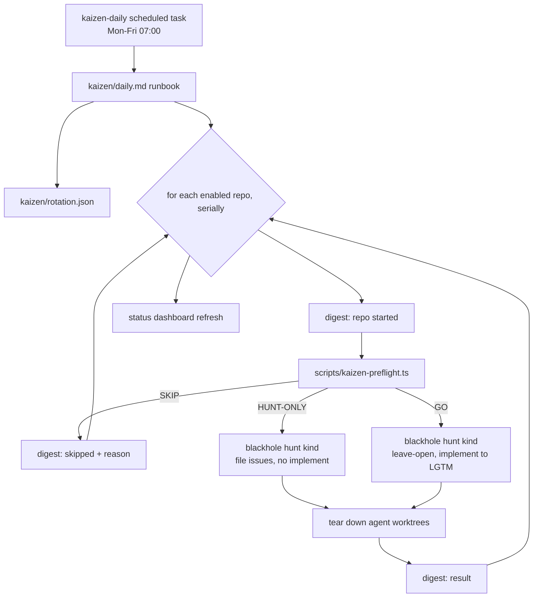

# ADR-053: Daily Weekday Kaizen Rotation

## Status

Accepted 2026-11-13 (owner approved approach A+ at the design gates). Input: `documentation/brainstorms/brainstorm-daily-kaizen-rotation.md`.

## Context

ADR-006 gave blackhole 13 hunt kinds and a full hunt → implement → review loop, but no time
trigger: hunting runs at queue exhaustion, every N loops, or by hand. The owner wants a
continuous-improvement cadence: one themed analysis every workday across ssl-management,
ai/mercure, ai/workflows and blackhole itself, ending in review-ready PRs the owner merges.

Three engine gaps block an unattended daily run today:

1. **Territory never resets.** `hunt_state.kinds.<k>` (`bands_done`, `waves`, `exhausted`) has
   no reset. One wave per kind per week reaches `max_waves: 6` in about six weeks, or sooner
   after three dry waves, after which the kind silently stops hunting.
2. **The launch form needs a question channel.** A headless run resolves to backend `none`
   (`run-context.md`); only the routine-resume carve-out skips the form.
3. **The ledger cannot count open kaizen PRs.** Under `leave-open`, an LGTM'd open PR counts as
   delivered and `fixed-in-pr` rows persist until a later sync observes the merge.

The workstation is ZFS-root and has run out of memory under parallel test load, so repos run one
at a time, builds and tests go through `with-test-lock`, and CI is the verdict.

## Decision

Approach **A+**: one scheduled task, a versioned runbook and rotation file, a preflight script,
and three small engine changes.

### Rotation

| Day | Kinds | Focus |
|-----|-------|-------|
| Mon | `bug` | correctness, error handling |
| Tue | `coverage` | test gaps on hot code |
| Wed | `refactor` | duplication, dead code, structure |
| Thu | `perf` | hotspots (`deps` is left to the existing weekly dependency-bump task) |
| Fri | `docs`, `quickwins` | stale docs, cheap wins |

### Flow

### Components

| # | Component | Location | Responsibility |
|---|-----------|----------|----------------|
| 1 | `kaizen-daily` task | `~/.claude/scheduled-tasks/kaizen-daily/SKILL.md` | Trigger only: a pointer to the runbook, so no logic lives outside git |
| 2 | Runbook | `kaizen/daily.md` | Select today's kinds, loop repos serially, call preflight, run the hunt, tear down, write digest |
| 3 | Rotation file | `kaizen/rotation.json` | Single source for day → kinds, repos (path, forge, `enabled`), per-repo time budget, `wip_cap: 3` |
| 4 | Preflight | `scripts/kaizen-preflight.ts` | Memory and load gates, forge sync, count of open PRs labelled `kaizen`; prints `GO`, `HUNT-ONLY` or `SKIP` with a reason |
| 5 | Territory reset | engine, `hunt` mode | `hunt <kind> --fresh-territory` clears that kind's `hunt_state` watermark at run start, so weekly cadence never exhausts it; ledger dedup still prevents re-filing |
| 6 | Non-interactive launch | engine, coordinator preflight | When the run context has no question channel and `.blackhole/config.json` is complete, the launch form is skipped and the persisted config is echoed to the digest instead |
| 7 | `kaizen` PR label | engine, implementer PR creation | PRs whose ledger origin is `phase: hunt` carry the `kaizen` label, the forge-side marker the preflight counts |
| 8 | Digest | status page (`status-page.md`) | A line written before each repo starts and updated after, so an interrupted run still shows how far it got |

Staged rollout: week 1 enables ssl-management only; one more repo is set `enabled: true` per week.

## Alternatives

| Approach | Score | Why not chosen |
|----------|-------|----------------|
| **A+** (chosen) | 8.2 | — |
| **C: native `kaizen.trigger: schedule`** with per-repo `rotation` and `wip_cap` in config | 6.4 | Strongest long-term home for the logic and benefits every blackhole user, but weeks before the first run and it makes unattended hunting the default path, which ADR-006's risk table warns against. Components 5–7 are its first steps, so A+ does not close the door |
| **B: five fixed tasks**, one per weekday | 4.1 | Limits a bad edit to one weekday, but the same loop is copied five times outside version control and a rollout step means editing five prompts |

## Design Principles

| Principle | Result | Note |
|-----------|--------|------|
| SRP | PASS | Trigger, policy (rotation), decision (preflight), execution (hunt) and reporting (digest) are separate |
| OCP | PASS | New kinds or repos are rotation.json edits, not code |
| LSP / ISP | N/A | No type hierarchies or interfaces introduced |
| DIP | PASS | Runbook depends on the preflight's three-value verdict, not on forge or `/proc` details |
| DRY | PASS | One loop (runbook), one config (rotation.json); dedup reuses the ledger idempotency key |
| KISS | PASS | No daemon or queue; a cron-fired prompt and one script |
| YAGNI | PASS | No per-repo rotations, adaptive scoring or always-on runner; each is a review trigger |
| SoC | PASS | Engine changes stay inside the components that already own the behaviour |
| Fail fast | PASS | Preflight decides before any agent spawns; a SKIP is recorded, not silent |
| Patterns | — | Behavioural: Strategy (kind per weekday selected from config) |

## Refactoring Impact

| Consumer | Change | Impact |
|----------|--------|--------|
| `hunt` mode callers | New optional `--fresh-territory` flag | TRANSPARENT |
| Coordinator launch form | New skip branch only when headless and config complete | TRANSPARENT for interactive runs |
| Implementer PR creation | Adds a label for `phase: hunt` origin | TRANSPARENT; the label must exist in each enabled repo |
| F-HUNT-01 conformance check (a) | Watermark may legitimately reset | DEPRECATION: the `waves <= max_waves` sanity check must read waves since the last reset |

## Key Assumptions

| Assumption | Marker | Note |
|------------|--------|------|
| Local scheduled tasks fire when the workstation is on and awake | ✓ Validated | Existing weekly tasks in `~/.claude/scheduled-tasks/` run this way |
| `hunt <kind>` runs with `kaizen.enabled: false` | ◐ Blind spot | Config-template calls `enabled` a kill switch; the plan must confirm, or the runbook sets `enabled: true, trigger: manual` per repo |
| Four repos fit before the working day | ~ Contestable | 4 × ~45 min ≈ 3 h; the staged rollout measures it before all four are on |
| Gitea and GitHub both accept a `kaizen` label | ✓ Validated | Both forges support repo labels; it must be created once per repo |
| ≥70% of kaizen PRs reach LGTM without manual fixes | ~ Contestable | Success metric, measured at the four-week review |

## Consequences

- Daily review load: up to one themed PR batch per enabled repo, capped at three open kaizen PRs
  per repo.
- Days the workstation is off or under memory pressure are recorded as skipped, not caught up.
- A four-week review decides whether to promote the rotation into the engine (approach C).
