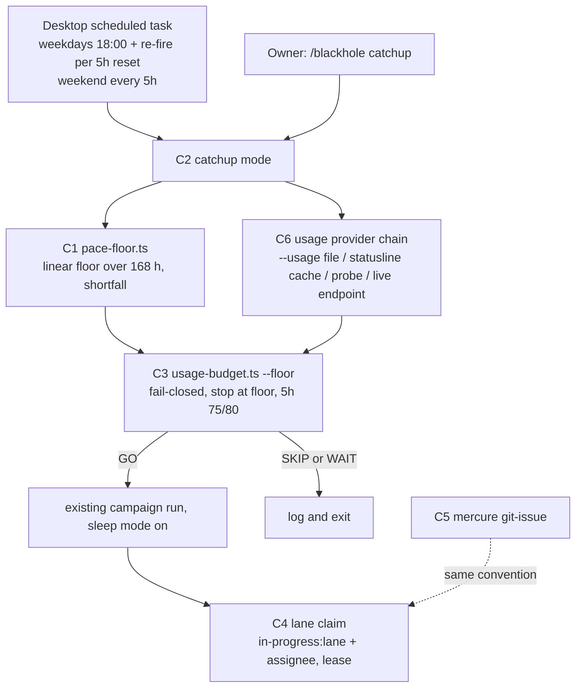

# ADR-054: Catchup mode — weekly quota pacing

## Status

Accepted, 2026-11-17 (owner-approved through design Gates 1-3 in the design session; mode name
`catchup` chosen over `drain`).

## Context

The owner's plan quota resets weekly. Interactive weekday work rarely uses all of it, so the
remainder is lost at each reset. The owner wants a 90% weekly cap, which is 17.5% per weekday
over five weekdays, with an 87.5% floor at reset. Whatever the day leaves below that pace should
be spent on backlog issues. Two constraints apply: a 5h window is never pushed past 80%, so
interactive work always has room, and a run never touches an issue held by another session,
colleague or account. The behaviour must be native to blackhole, so the owner can trigger it by
hand, and it must work on every host: CLI, desktop app and cloud.

Requirements, priorities and the capacity model are in the brainstorm
(`documentation/brainstorms/weekly-quota-pacing.md`). The key capacity fact,
owner-observed: one full 5h window is 11-17% of the weekly quota, so one window at the 80% cap
burns at most 8.8-13.6%. Covering one weekday of pace takes 1.3-2 windows, which is why a
single 6pm run cannot work.

What blackhole already has:

- `usage_budget` (`config-template.md`): 5h `no_spawn_at`/`stop_workers_at`, weekly
  `stop_campaign_at`, `target_at_reset`, `PACE-WAIT` with `wake_at`.
- `sleep_mode`: owner questions are parked while nobody is present.
- `forge-sync`: blocks issues that carry a foreign `in-progress:*`/`agent:*` label.

The gaps:

- No floor trigger.
- Unreadable usage resolves to `unavailable`, and `unavailable` means GO.
- Usage is readable only from the statusline cache or a remote probe, so a desktop scheduled
  session reads nothing.
- Nothing writes a claim. Every `blackhole/` branch counts as "own", so two accounts' runs do not
  block each other.
- On a local host nothing wakes the run between 5h windows.

## Decision

Add a `catchup` mode (Option A). It is a dedicated entry point that computes the pace floor,
exits when usage is already at or above it, and otherwise runs the normal campaign with a floor
stop.

### Components

| # | Component | Responsibility | New or extended |
|---|---|---|---|
| C1 | `scripts/lib/pace-floor.ts` | Pure function: given now, the weekly `resets_at` and `weekly_target_pct`, returns the floor, the elapsed hours and the shortfall. The floor is linear over all 168 h of the week: `weekly_target_pct x elapsed_h / 168`, where `elapsed_h` is the time since `resets_at - 7d` clamped to 0-168. Weekends count like weekdays, so the curve is an output of the reset time, not a constant | New; reparameterized (see § Post-acceptance amendments) |
| C2 | `catchup` mode (`SKILL.md` Modes row, `src/references/phase-catchup.md`) | Entry point, used the same way as `run` and `stop`: `/blackhole run`, `/blackhole catchup`, `/blackhole stop`. Runs C3, logs and exits on SKIP/WAIT, otherwise starts the campaign. Before the first spawn it runs the existing launch gate (`launch-gate.md`), widened from `run` only to `run` and `catchup`. The gate behaves the same for both modes: it prints the whole configuration as an executive summary and asks Accept/Adjust per section. For `catchup`, the rows come pre-filled with the pacing preset as defaults: the floor from C1, the 5h caps (75/80) and the lane. Every row stays adjustable, exactly as in `run`. A pacing section adds the usage reading (plan, every window with used % and reset) and the shortfall. Adjustments apply to that invocation only, never to `config.json`. A scheduled catchup has nobody to answer, so it runs in the gate's existing print-only mode (sleep mode on, or no question channel): the summary is printed and every row counts as accepted. `stop` drains a catchup exactly as it drains a run. The playbook also holds the scheduled-task prompt template, so cloning per account is copy and set `lane` | New (`launch-gate.md` § When it runs extended) |
| C3 | `scripts/usage-budget.ts --floor <pct>` | One usage gate, not a second implementation. With `--floor`, unreadable usage is SKIP (fail-closed). The floor replaces `stop_campaign_at` for this invocation only, and the 5h lines come from the `catchup` config block (`no_spawn_at: 75`, `stop_workers_at: 80`). `config.json` is never mutated | Extended |
| C4 | Lane claim (forge adapter `claim`/`release`, `forge-sync`, `blocked-classes.ts`) | Before work: add `in-progress:<lane>` and assign the account user. Release on merge, stop or failure. `lane` is an account-stable config key that replaces the hardcoded `OWN_LANES`. An issue counts as "own" when it carries the own lane label, not because of a `blackhole/` branch prefix. A claim with no branch or PR activity past `claim_lease_hours` is stale and reclaimable | Extended (adapter interface) |
| C5 | mercure `git-issue` implement | Writes and respects the same label and assignee convention, so interactive sessions are visible to campaigns | Separate PR, mercure repo |
| C6 | `scripts/usage.ts` + `usage-source.ts` provider chain | Prints one normalized reading on any host, and that reading describes the subscription fully: `plan` (e.g. Pro, Max, or `none` for API-key, Bedrock or Vertex billing, where plan limits do not apply), `windows[]` (only the windows the plan actually has: 5-hour, weekly all-models, and each per-model weekly window, each with `used_pct` and `resets_at`), `extra_usage` (enabled, currency), `source` and `read_at`. A plan without a 5-hour window gates on the weekly window alone, and a plan with no windows makes `catchup` a SKIP with reason `no plan limits`. Ordered providers, first usable wins: (1) explicit `--usage <file>`, which the desktop scheduled task fills from the app's own usage tool and any agent can fill; (2) the statusline rate-limit cache, on an interactive CLI; (3) the `rate_limit_event` probe, on cloud and remote; (4) the account's live usage endpoint, if verified (see Key Assumptions). No provider gives `none` with a reason, and C3 turns that into SKIP | Extended |
| — | `catchup` config block | `weekly_target_pct` (80), `five_hour` caps (75/80), `lane`, `claim_lease_hours` | New keys (`V-CONFIG-02`, `V-CONFIG-03` status dataset) |

The scheduled task stays outside the repo, as a desktop app or cloud routine schedule. Because the
mode is native, the task's prompt is one line plus the usage hand-off, and a local host's missing
wake-up between 5h windows is covered by the schedule re-firing (about 18:00, 23:00 and 04:00 on
weekdays, every 5h on weekends).

### Design Principles Validation

| Principle | Result | Note |
|---|---|---|
| SRP | Pass | Floor math (C1), gating (C3), reading (C6) and claiming (C4) are separate. The mode (C2) only composes them |
| OCP | Pass | `--floor` and the provider chain extend existing modules. Adapters gain methods rather than per-forge branches in callers |
| LSP | Pass | The three adapters each implement `claim`/`release` with the same contract |
| ISP | Pass | `claim`/`release` sit on the adapter interface every forge already implements, so there are no stubs |
| DIP | Pass | C3 receives a reading from the C6 chain. It does not read files or call hosts itself |
| DRY / V-INT-02 | Pass | Reuses `usage-budget.ts`, `PACE-WAIT`, `sleep_mode` and `blocked-classes.ts`. No second gate and no second label parser |
| KISS | Pass | A script, not an MCP server, for usage (see Alternatives) |
| YAGNI | Warn | Provider (4) is included only if verification passes. Otherwise it is dropped, not stubbed |
| Fail fast | Pass | Unreadable usage, an invalid config block or an unknown lane fail at the gate, before any spawn |
| Patterns | Chain of Responsibility (C6 providers), Strategy (forge adapters, already present) | — |

## Alternatives Considered

- **Option B: a floor policy inside `usage_budget` (`weekly.floor_curve`).** Every `run` would
  become floor-aware, with no new mode. Strongest case: one policy, nothing new to learn.
  Rejected because it mixes a start trigger with a stop condition. A manual run when usage is
  ahead of pace would refuse to start or stop early. It also collides with `target_at_reset`
  validation, and making it trigger-only reduces it to Option A with extra steps (critic score
  about 6/10 against about 8/10).
- **Name `drain`.** Rejected. "Drain" already means graceful stop in 12 files, including the
  persisted `stop_kind: drained` checkpoint value and the `stop` trigger "drain the campaign", so
  the new mode would invert an existing meaning.
- **An MCP server for usage.** Rejected for v1. Scripts and the gate cannot call MCP tools, and
  agents already reach the hosts' own usage tools, so a normalized script with a `--usage` file
  hand-off covers every host. Revisit if a host appears where only an MCP tool can read usage.
- **Per-run overrides by editing `config.json`.** Rejected. A crash leaves the overrides in place,
  and a concurrent manual run would inherit them.
- **A shared lock file for claims.** Rejected. It only works on one machine, and claims must hold
  across accounts and colleagues.

## Consequences

### Refactoring Impact

| Consumer | Change | Impact |
|---|---|---|
| `usage-budget.ts` callers (orchestrator dispatch, `pace-log.ts`) | New optional `--floor`; default behaviour unchanged | TRANSPARENT |
| `usage-source.ts` callers (`usage-budget.ts`, `pace-gate.ts`) | Single cache source becomes an ordered chain; first provider equals today's behaviour | TRANSPARENT |
| Forge adapters (GitHub, Gitea, GitLab) | Must implement `claim`/`release` | BREAKING (all 3 in one change) |
| `blocked-classes.ts` `OWN_LANES`, `forge-sync.ts` own-branch rule | Own lane comes from config; ownership comes from the lane label, not the branch prefix | DEPRECATION: hardcoded lanes are kept as the fallback when `lane` is absent, then removed |
| mercure `git-issue` | Adopts the label and assignee convention | Separate repo, separate PR |

Migration order: C1 → C6 → C3 → C2 (the mode is usable on a single account) → C4 → C5. Until C4
lands, `catchup` relies only on the existing foreign-label blocking, so running it on more than
one account is unsafe until then.

### Key Assumptions

| Marker | Assumption | Evidence or action |
|---|---|---|
| ✓ | The desktop app exposes 5h and weekly usage with reset times | Read live on 2026-11-17 (5h 9%, weekly 5%, reset Tue 10:00Z) |
| ✓ | The interactive CLI writes the statusline cache | Existing `pace-gate.ts`/`usage-source.ts` behaviour |
| ~ | One 5h window is 11-17% of weekly | Owner-observed; differs by model. Burn runs should pin the cheaper model where `model-routing.md` allows |
| ⚡ | "Never above 80%" is one threshold | Workers already running finish after no-spawn, so the gate stops new spawns at 75 and stops workers at 80 |
| ◐ | A desktop scheduled-task session can call the app's usage tool | Verify in the first plan task; if not, the task falls back to provider (4) or skips |
| ◐ | The account's live usage endpoint is stable and acceptable to call with the session's own credentials | Undocumented. Verify before building provider (4), and drop it if not |
| ◐ | `claim_lease_hours` (default 24) exceeds the longest legitimate review wait | Calibrate against `pace-log.jsonl` and merge history |

### Other Consequences

- Fail-closed applies only under `--floor`. Normal runs keep today's `unavailable` meaning GO, so
  no existing campaign changes behaviour.
- Usage is per account. Each subscription runs its own scheduled task with its own `lane`.
  Collision safety between them comes from C4, not from usage.
- A week with no ready issues still wastes quota. `catchup` can only spend tokens on real backlog
  work, and it reports "no ready work" as its own skip reason.

## Post-acceptance amendments

- 2026-11-18 (issue #1293, owner ruling of that date): C1's weekday-credit staircase is replaced by a
  linear floor over the whole week. The staircase credited 17.5 points per finished Mon-Fri weekday
  (`pct_per_weekday`, with a working-day end hour `day_end_hour`), so the floor lagged the clock by up
  to 17.5 points inside a weekday, stayed flat from Friday evening to Monday evening and ignored the
  hours left before `resets_at`; at Wed 13:00Z of a Sat 20:00Z reset it showed 35% where the linear
  value is 42.38%. The floor is now `weekly_target_pct x elapsed_h / 168` with `weekly_target_pct` in
  (0, 100], default 80, and `computePaceFloor` returns `{ floor_pct, elapsed_h, target_pct,
  shortfall_pct }`. The 87.5 floor in Context was the owner's earlier figure and is now one
  configurable value (default 80). `catchup.pct_per_weekday` and `catchup.day_end_hour` are removed:
  `resolveCatchup` throws a message naming the replacement when either is present, even as `null`,
  and no auto-migration runs. The decision itself (a pace floor gated fail-closed by `--floor`) is
  unchanged.
