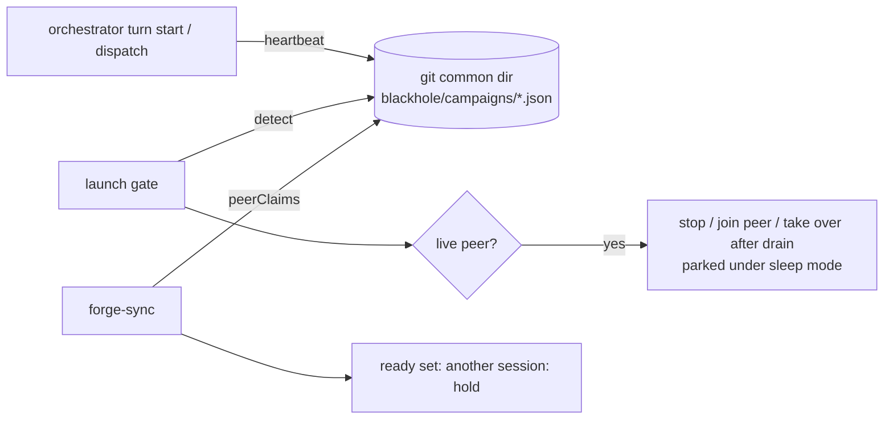

# ADR-057: Peer campaign detection through a git-common-dir heartbeat registry

## Status

Accepted, 2026-11-18. The design-aggregate verdict was `blocked` (dominance, disagreement), as recorded under § Gate; the orchestrator approved Option B under `autonomy.mode: full` (owner decision 10). Shipped in two PRs: detection and the launch-gate question first, then the forge-sync `another session:` hold.

## Context

Two `run` campaigns on one clone and one account ran at once without either noticing (issue #1267). The launch gate printed `Peers: solo`. The lane (ADR-054 C4) is per account, so forge-sync linked a same-lane peer PR as its own, and the claim answered `ALREADY-OWN`.

## Decision

Option B. Each campaign session keeps one heartbeat record under `$(git rev-parse --git-common-dir)/blackhole/campaigns/<session>.json`:

- **Contents**: `session`, `worktree`, `host`, `host_session`, `role`, `turn`, `heartbeat_at` and `claims[]`. The claims are every non-done queue entry that is `in-flight` or carries an open `pr`.
- **Refresh**: at each orchestrator turn start (every wake included), at each spawn round and at triage. Nothing refreshes it between turns, so a campaign idle or paused for longer than the lease is invisible to peers until its next turn.
- **Removal**: on stop and on campaign complete.
- **Liveness**: a record is live within a 40-minute lease, the grant lease in `multitask-mode.md`.

The launch gate runs `heartbeat` and then `detect`:

- **Live peer found**: it asks stop / join as `peer` / take over after the other drains.
- **Join option**: offered only when the peer recorded a `host_session`, which requires a host with a cross-session message tool.
- **Sleep or print-only mode**: it parks the question and refuses to start.

forge-sync holds every live peer's claimed issue with `another session: <session>`. The issue leaves the ready set, and the own-PR link skips it. The Peers row states reach `clone`.
## Requirements Framing

Route (ledger routing decision for #1267): needs_investigation, needs_analysis, needs_design, needs_clarification; plan_mode full; size l; task_type feature. The clarification is resolved by the issue body itself: on detection the session offers **stop**, **join as `peer`** (shared usage budget) or **take over after the other drains**, and it never starts silently as `solo`. That policy is an input here, not a design choice.

Observed failure (issue #1267): two `run` campaigns on one repo and one account ran at once, in two worktrees of the same clone, each with its own `.blackhole/` state. Session B's launch gate printed `Peers: solo`, and its forge sync computed a ready set that included issues session A had claimed.

Verified root causes at `origin/main` 4c0b6699:

1. **Nothing reads another session's existence.** The Peers row (`scripts/lib/campaign-status/launch-summary.ts:230-238`) renders only the configured `usage_budget.coordination.role`. With the default `solo`, it prints `solo` unconditionally.
2. **The lane is per account, not per session.** `openPrIndex` (`scripts/lib/forge-sync.ts:69-92`) treats every same-lane `claude|blackhole/issue-N` PR as the campaign's own. The sync then **links** that PR into this queue (`forge-sync.ts:191-195`), so B would adopt A's PR as its own review.
3. **The claim cannot tell two sessions apart.** `claim.ts` answers `ALREADY-OWN` for a same-account, same-lane claim (`scripts/lib/forge-adapter/claim.ts:54`).
4. **The existing rule has no detector.** `multitask-mode.md` forbids a second live orchestrator, but nothing can see one that started in a different session.

Required outcome:
- (R1) Bootstrap detects a live peer campaign before the launch gate's questions.
- (R2) On detection, the gate asks stop / join / take over. Under sleep or print-only mode it parks that question and refuses to start, the same as an unset `merge_mode` (R-002 spirit).
- (R3) The ready set excludes issues claimed by another live session. A peer's PR is never linked as this session's own.
- (R4) No silent `solo`: a clean result states its reach.

Binding constraints:
- ADR-003: pure lib plus a thin CLI.
- `blackhole-state.md` § Write protocol: atomic writes.
- The lane vocabulary (ADR-054 C4) stays per account.
- R-005: this is not a stacking toggle.
- No new V-code. `VCODE_TABLE_ROW_COUNT` is contended by #1268.

Rejected before scoring: the **checkpoint PR** mechanism named in the issue. The repo has no `docs(campaign): checkpoint turn N` PR. Its nearest relative, the `blackhole/state` branch (`state-branch.md`), is pushed only when `state_store: branch`. Local-store campaigns, the incident's topology, never push it. It also lands only at turn end, so it cannot be a detector.

## Options + Trade-off Matrix

Decision type `architecture-choice` (`design-rubric.md`). Weights: Risk 30, Maintainability 25, Complexity 20, Reversibility 15, Consistency 10. Scores are 1-5, where 5 is best.

| Option | Summary | Risk | Maint. | Complexity | Revers. | Consistency | Weighted |
|---|---|---|---|---|---|---|---|
| A: Forge recency | Own-lane `in-progress:*` claims and open own-branch PRs updated in the last 40 min that this queue does not own count as a peer, and are held with an `another session:` note | 2 | 3 | 4 | 4 | 3 | 3.05 |
| B: Git-common-dir heartbeat registry | One JSON per session under `$(git rev-parse --git-common-dir)/blackhole/campaigns/`, refreshed each turn and at dispatch, with a 40-min lease. Self is identified by a local token. Live peers' `claims[]` are held with `another session:` | 4 | 4 | 3 | 4 | 4 | 3.80 |
| C: Layered B + A | The B registry is authoritative, and A's forge leg adds a `suspected` signal for peers outside the clone | 3 | 3 | 2 | 3 | 3 | 2.80 |

Chosen (primary, provisional): **Option B**. No ADR citation was used as decisive evidence.

## Adversarial Evaluation

Two blind critique-only `planner` sub-invocations scored the options with Chosen stripped. Raw JSON is in `.blackhole/plans/issue-1267-design-input.json`.

- **Both critics** tag a `discriminating` **CRITICAL** on Option A, for different defects. A peer that has not yet claimed anything is invisible, so the gate still prints `solo`. And with no session identity on same-account claims, a session that lost its state reads its own claims as a peer's.
- Critic A's weighted matrix still ranks A first (Complexity/Reversibility), narrowly. Critic B ranks B first.
- Both critics tag C NOTABLE: it inherits A's spoofing and false positives unless `suspected` never holds, which removes the reason for the layer.
- Option B NOTABLEs, all addressed in the Decision below:
  - Reach is one clone. The gate must say so, never render a bare `solo`.
  - No campaign pid: liveness rests on turn heartbeats, so a crashed peer holds its claims for up to one lease, and a turn longer than the lease could read as dead.
  - Self-identification through a token plus a same worktree+host superseded-self rule is the delicate part. It needs atomic writes and torn-read tolerance.
  - The registry lives outside `.blackhole/`.

## Component Decomposition

| Component | Responsibility |
|---|---|
| `scripts/lib/peer-campaigns.ts` (new, pure) | `PeerRecord` type. `parseRecord` (torn read gives null). `livePeers(records, self, nowMs, leaseMs)` excludes self and superseded-self (same `worktree` and `host`) and expired leases. `peerClaims(peers)`: issue to `another session: <session>` note. Clock and paths are parameters |
| `scripts/peer-campaigns.ts` (new CLI) | `heartbeat` writes or refreshes own record (claims = every non-done queue entry that is `in-flight` or carries `pr != null`) via `writeJsonAtomic`. `detect` prints `{verdict: solo\|peers, reach: "clone", peers[]}`. `release` removes own record |
| `scripts/lib/forge-sync.ts` | Optional `peerClaims` input. A peer-claimed `ready` entry gets an `another session:` note through `applyLane`, and `LANE_NOTE` widens so the own-PR link (L192) skips it |
| `scripts/lib/campaign-status/launch-summary.ts` | Peers row from `detect`: live peers name worktree, turn and heartbeat age. Clean is `solo (no live peer in this clone)` |
| Prose: `launch-gate.md`, `multitask-mode.md`, `orchestrator-runtime.md`, `phase-stop.md`, `queue-dag.md`, `forge-sync.md` | Gate question and print-only park, turn-start and dispatch heartbeat, release on stop, Step 2 condition 6 |



## Design Principles Validation

| Axis | Score | Justification |
|---|---|---|
| SRP | ✓ | Liveness logic lives in one pure module. CLI, sync and summary only consume it |
| OCP/DIP | ✓ | `syncQueue` and `buildLaunchSummary` gain optional inputs. Absent means today's behaviour, and git and clock are injected |
| DRY | ✓ | Reuses `applyLane`/`LANE_NOTE` for the hold, `writeJsonAtomic` for writes, the 40-minute lease from `multitask-mode.md` and `parseFlags` |
| KISS | ~ | A new state location and lifecycle, but one file per session needs no lock |
| YAGNI | ✓ | No forge leg and no cross-machine reach until a cross-clone incident is reported |
| Pattern | ✓ | Same shape as the `sleep-hold.ts` local record and the lane-hold note |

## Refactoring Impact Analysis

| Consumer | Classification | Note |
|---|---|---|
| `scripts/forge-sync.ts:76` | TRANSPARENT | `syncQueue` gets optional `peerClaims`; absent means no peers |
| `scripts/lib/forge-sync.ts:192` | TRANSPARENT | The own-PR link already skips lane-noted entries; the widened `LANE_NOTE` covers `another session:` |
| `scripts/lib/forge-sync.ts:133-138` (`applyLane`) | TRANSPARENT | Same hold/release contract, new note text |
| `scripts/campaign-status.ts:320` | TRANSPARENT | `buildLaunchSummary` gets optional `peers` |
| `scripts/lib/campaign-status/blocked-classes.ts:61` | TRANSPARENT | An `another session:` note joins the `another_lane` class (additive) |

There are four consumers, so `## Dependency Blast-Radius` is required in the plan.

## Assumption Audit

| Assumption | Mark | Note |
|---|---|---|
| The incident's two sessions shared one git common dir | ✓ | Both worktrees are `.claude/worktrees/*` of one clone (issue body) |
| A turn heartbeat inside 40 minutes is enough | ~ | Heartbeat also at each spawn round and triage, so a long turn refreshes. The residual is a turn over 40 min with no spawn |
| Cross-clone and cross-machine peers are rare | ◐ | Not reported. The Peers row states reach `clone` so the gap is visible, not silent |
| A forged registry file is out of the threat model | ✓ | It needs local write to `.git/`, the same trust as `queue.json` |
| Two sessions can still race one dispatch between syncs | ~ | The heartbeat at dispatch shrinks the window to seconds; `claim.ts` is unchanged |
| A stale record from a crashed session clears by itself | ✓ | Lease expiry. "Take over after drain" resolves to it |
| An idle live session keeps its lease | ~ | Only while a turn starts within the lease: heartbeats run at turn start, spawn rounds and triage, never between turns. A paused or idle session past 40 minutes lapses and is invisible until its next turn; a stopped one releases its record |
| A second session in the same worktree is visible | ✗ | It shares the local token and the `.blackhole/` dir, so it reads as self. Out of scope: one `.blackhole/` already allows one campaign (`multitask-mode.md`) |
| Join as peer works on every host | ◐ | Needs a cross-session message tool (`claude-code-native.md` § Cross-session budget transport, Remote only today). Elsewhere `host_session` is null, so the gate offers only stop / take over |
| Two bootstraps at the same moment both read solo | ~ | The gate runs `heartbeat` before `detect`, so the later one sees the earlier |

## Gate

`autonomy.design_autonomy` is absent, so it defaults to `true`. `scripts/design-aggregate.ts` was run on `.blackhole/plans/issue-1267-design-input.json`, and its output was saved to `issue-1267-design-verdict.json`:

```json
{"status":"blocked","winner":null,"reasons":["dominance","disagreement"],
 "scorer_results":[{"scorer":"primary","winner":"Option B","margin":19.74},
                   {"scorer":"critic_a","winner":"Option A","margin":11.48},
                   {"scorer":"critic_b","winner":"Option B","margin":10.53}]}
```

**Verdict: `blocked`** (dominance and disagreement; not unanimous; the script names no winner). The planner does not override it (V-AUTO-01).

**Decision.** The planner recommended B, and the orchestrator approved B under `autonomy.mode: full` (owner decision 10).

Disclosures:
- **Scoring order.** The primary matrix was finalized after both critic reports had arrived. Its B row matches critic B's, and its A row matches critic A's. So the primary is not an independent third vote, and the independent evidence is one critic each way.
- **Reshaped input.** Critic B returned `per_option_scores` as an array keyed `A`/`B`/`C`, and critic A keyed its scores `A`/`B`/`C`. Both were reshaped to the `Option X` keys without changing any value.

### What the owner needs to decide (R-003 executive summary)

- **Decision**: approve Option B. A heartbeat registry in the git common dir detects a live peer campaign at bootstrap, and its claims leave the ready set through an `another session:` hold.
- **Why now**: two campaigns already ran blind on one clone (issue #1267). The next overlap duplicates PRs, collides on ADR and migration numbers, and double-spends one account budget.
- **Evidence**:
  - The independent critics split: critic A's matrix picks A narrowly, on simplicity; critic B picks B.
  - Both critics put a discriminating CRITICAL on A. It is blind until a peer claims something, and it reads a state-lost session's own claims as a peer's. That would block A in the aggregate as well.
- **Recommended**: B, with reach `clone` stated on the Peers row. Add a forge leg only if a cross-clone overlap is ever reported.
- **Alternative**: A (forge recency). It is simpler and reaches other machines, but it misses a just-started peer, which is the original failure.

## Alternatives Considered

- **Option A, forge recency**: it is blind to a peer that has just started, and it cannot tell a state-lost session's own claims from a peer's.
- **Option C, layered**: it adds A's false positives for a reach nobody has reported.
- **Checkpoint PR**: no such mechanism exists, and the state branch is pushed only when `state_store: branch`.

## Consequences

- A session in another clone or on another machine is still undetected. The Peers row says `reach: clone`, so this gap is never shown as a clean `solo`.
- A crashed session holds its claims for up to one 40-minute lease.
- The registry lives outside `.blackhole/`. It is local per clone, never pushed, and needs no `.gitignore` entry.

## Post-acceptance amendments

- 2026-11-23 (issue #1408): self is no longer identified only by the campaign-dir token. That token
  (`<campaign dir>/.tmp/campaign-session.json`) is shared by every session on one campaign
  directory, so two sessions there kept one record and `detect` returned `solo` for both.
  - **Id source**: where the host sets `CLAUDE_CODE_SESSION_ID` and it is a valid session id, it
    is the session id (`sessionIdentity`, `scripts/peer-campaigns.ts`). A set but unusable value
    falls back to the token and prints a stderr warning; an absent one falls back silently. A
    Task-spawned orchestrator shares its coordinator's id, so one campaign keeps one record.
  - **Self rule**: self is now the session's own record plus the earlier sessions
    `supersededSessions` (`scripts/lib/peer-campaigns.ts`) names; a record from the same worktree
    on the same host is no longer self by that fact alone, so a concurrent session on the same
    campaign directory is a peer and the launch gate asks the peer question.
  - **Predecessor marker**: to keep this ADR's discriminating CRITICAL closed (a state-lost
    session must not read its own claims as a peer's), each record carries `host_pid`
    (`CLAUDE_PID`, optional, older records read as null), and a host-scoped session writes its id
    to its own file, `<campaign dir>/.tmp/campaign-last-session.json`; the token file stays
    token-mode only, so a token-mode session never adopts a host session's id. A same-worktree,
    same-host record is this campaign's earlier session, read as self and removed by `heartbeat`,
    when its host process is this one (`/clear`) or is gone (a resume or fork in a new process).
    With no pid recorded, it is an earlier session for a token id (the original lost-token rule),
    and for a host id only when it carries the last-session or token id and has not heartbeated
    since this session's first heartbeat. A record whose host process is alive is always a peer,
    token mode included.
  - **Residuals**:
    - With no host session id (Cursor, Codex, a plain shell), two token-mode sessions on one
      campaign directory still share one id and stay unseen.
    - With a host session id but no `CLAUDE_PID`, the second session's first heartbeat has no
      start time of its own, so it reads the live last session as superseded and removes its
      record, and `detect` at that session's launch gate returns `solo`: the #1408 symptom. It
      lasts until the other session's next heartbeat recreates its record. Exposure is limited
      because Claude Code sets both variables.
    - Liveness is `kill(pid, 0)` only: a reused pid reads a gone predecessor as alive, so it
      shows as a peer until its 40-minute lease ends. Comparing the process start time would
      harden this; it is a known limit, not implemented.
