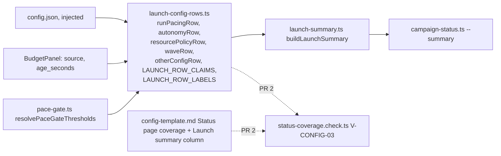

# ADR-058: Launch summary config coverage (issue #1277)

## Requirements Framing

Route (queue.json `issues["1277"].route`): feature, `plan_mode: full`, `needs_split`,
`needs_design`, `needs_analysis`, `needs_clarification` all true, size `l`. The clarification is
resolved under `autonomy.mode: full`: the issue's "Expected" section is the spec.

`bun run scripts/campaign-status.ts --summary` builds its rows in
`scripts/lib/campaign-status/launch-summary.ts` `buildLaunchSummary` (origin/main
`launch-summary.ts:326-336`): eight rows in a `run`, nine in a `catchup`. The owner accepted a
gate that never showed `autonomy.mode: full`, the `resource_policy` carve-out and its
conditions, `wave_scheduling`, or that the Budget row's "pacing off" meant `usage_budget` was
absent rather than configured. Requirements:

1. A **Pacing** row on every `run`: `usage_budget` present / absent / invalid, its thresholds,
   `resource_policy.pace`, and the reading's source and age. "Absent from config" must read
   differently from "configured but not probed".
2. **Autonomy**, **Resource policy** and **Wave scheduling** rows, each with a one-line
   consequence (at most `MAX_CONSEQUENCE_CHARS` = 140, `launch-summary.ts:23`).
3. An **Other config** row: no config key is dropped silently.
4. `V-CONFIG-03` (`scripts/checks/status-coverage.check.ts`) extended to the launch summary, so a
   new config block cannot ship without a summary declaration.

Fixed constraints (not decided here): the new rows go in a sibling module because
`launch-summary.ts` is already 395 lines (V-PAT-01). The new rows are display-only, so the gate
keeps its card count ("a full gate is 2 cards", `launch-gate.md` § Questions). Two PRs.

## Options + Trade-off Matrix

The decision: **how rows claim config keys, and where launch-summary coverage is declared and
enforced.**

- **Option A**: per-block claims in code. An exported `LAUNCH_ROW_CLAIMS` maps each row key to
  the top-level blocks it renders. A claim may also name the depth-1 sub-keys the row renders, so
  the row's other sub-keys fall through to Other config. Other config lists, by name only, every
  live top-level key no row claims, plus each unrendered sub-key of a block whose claim names its
  keys. Coverage is declared in a `Launch summary` column appended to the existing
  `## Status page coverage` table: a row label, or `Other config`. V-CONFIG-03 cross-checks that
  column against `LAUNCH_ROW_CLAIMS` in both directions.
- **Option B**: per-leaf claims. Each row declares every dotted leaf it renders. Other config
  lists every unrendered leaf, and the check runs over every registered dotted key (about 200).
- **Option C**: per-block claims in code as in A, but declared in a new separate
  `## Launch summary coverage` table, with its own parser and gap function.

Rubric `architecture-choice` (`design-rubric.md`), weights Risk 30 / Maintainability 25 /
Complexity 20 / Reversibility 15 / Consistency 10. Primary matrix:

| Option | Risk | Maintainability | Complexity | Reversibility | Consistency | Weighted |
|--------|------|-----------------|------------|---------------|-------------|----------|
| A | 4 | 4 | 4 | 4 | 5 | **4.10** |
| B | 3 | 2 | 2 | 3 | 2 | 2.45 |
| C | 4 | 3 | 3 | 4 | 3 | 3.45 |

Chosen: **Option A**.

No ADR is cited as decisive evidence for any option (`adr_citations: []`).

## Adversarial Evaluation

Two blind `planner` critics scored the options without seeing the provisional Chosen
(`issue-1277-design-input.json`). Both gave A 4.10, C 3.45 and B 1.80.

- **Both critics, on A (NOTABLE, discriminating)**: pure per-block claims hide unregistered
  nested keys (`autonomy.merge_note`, `resource_policy.carveout_recorded_at`), which partly
  fails "no key dropped". **Adopted**: the depth-1 sub-key claim above. A claim such as
  `{ block: 'resource_policy', keys: [...] }` sends every other live sub-key to Other config. The
  mitigation stays at depth 1 to avoid B's leaf explosion.
- **Both, on A (NOTABLE)**: `parseCoverageTable` reads columns by position
  (`status-coverage.check.ts:23-37`). The new column is **appended** after Reason and never
  inserted. An empty cell on a top-level block means undeclared and fails.
- **Both, on B (CRITICAL, discriminating)**: leaf coverage over about 200 prose-parsed keys has
  no stable identity for arrays or open maps, and makes every tunable a blocking declaration.
  Its likely bulk "other" escape hatch would defeat the check.
- **Both, on C (NOTABLE, discriminating)**: a second table, parser and gap function duplicate
  `status-coverage.check.ts` (V-DRY-01, V-INT-03), and two declarations per block can drift.
- **Domain-inherent**: the claim map needs a both-directions check and a sub-block rule
  (`usage_budget.coordination` belongs to Peers). Other config must stay pure over the injected
  config (`buildLaunchSummary` does no I/O).

`design-aggregate.ts` (`issue-1277-design-verdict.json`) returned `status: blocked`,
`reasons: ["dominance"]`. All three scorers chose Option A with a 15.85% margin, under the 30%
`design_dominance_delta`.

## Component Decomposition

- `launch-config-rows.ts` (new, PR 1): the four new row builders and the claims and labels
  registry. It is pure, like `status-page-row.ts`.
- `launch-summary.ts`: composes the rows in `LAUNCH_ROW_KEYS` order. A catchup puts its own
  `pacingRow` in the Pacing slot.
- `status-coverage.check.ts` (PR 2): parses the appended column and cross-checks it against
  `LAUNCH_ROW_CLAIMS` and `LAUNCH_ROW_LABELS`.

## Design Principles Validation

| Axis | Score | Justification |
|------|-------|---------------|
| SRP | ✓ | Row builders live in one module and composition in another; the check only compares declarations. |
| OCP | ✓ | A new block adds a claim entry and a table cell; no type-tag switch is edited. |
| DRY | ✓ | One coverage table per block, and the pace thresholds come from `resolvePaceGateThresholds`. |
| KISS | ~ | Depth-1 sub-key claims add a second claim shape, kept to the four rows that need it. |
| YAGNI | ✓ | No new V-code, no new check module, no new card. |
| Pattern | ✓ | Same declared-doc vs emitted-code cross-check as `PANEL_ROW_KEYS` (`status-coverage.check.ts:62-66`). |

## Refactoring Impact Analysis

Production consumers only. In-module test expectations and the two `fixtures/campaign-status/full/launch-summary*.expected.md` snapshots are spec assertions. TDD
red-first changes them, and they are listed in the plan's Dependency Blast-Radius.

| Consumer | Classification | Note |
|----------|----------------|------|
| `scripts/campaign-status.ts:370` | TRANSPARENT | `buildLaunchSummary` signature unchanged; the rows array grows |
| `scripts/lib/campaign-status/launch-summary.ts:19` | TRANSPARENT | Re-exports `LAUNCH_ROW_KEYS`; `CATCHUP_ROW_KEYS` collapses into it |
| `scripts/checks/status-coverage.check.ts:23` | TRANSPARENT | `parseCoverageTable` gains an appended 5th column; `cols[0..3]` unchanged |
| `src/references/coordinator-dashboard.md:41` | DEPRECATION | "eight rows" / "nine rows" prose goes stale; PR 1 updates it |
| `src/references/launch-gate.md:61` | DEPRECATION | Catchup form "run rows plus Pacing" goes stale; PR 1 updates it |
| `src/references/blackhole-vcodes.md:96` | DEPRECATION | V-CONFIG-03 rule text extended in PR 2 (hot file, one per wave) |

## Assumption Audit

| Assumption | Mark | Note |
|------------|------|------|
| `BudgetPanel.source` and `age_seconds` carry the reading provenance | ✓ | `types.ts` BudgetPanel fields at 400 and 417 on origin/main |
| `resolveBudgetSettings` fills defaults, so "absent" needs raw key presence | ✓ | Checked with `'usage_budget' in config`, not the resolved settings |
| Display-only rows keep the gate at 2 cards | ✓ | `gateCards` filters on `adjustable` (`launch-summary.ts:356`) |
| Other config listing key names, never values, leaks nothing | ✓ | `fan_out_override` is a ~600-char string; values stay off the row |
| A single key list makes Other config readable | ~ | About 15 keys on the live config; a long cell is accepted over dropping any key |
| Depth-1 claims cover the nested keys owners care about | ◐ | Depth-2 unregistered keys (inside `testlock_carveout`) stay hidden; accepted |
| Collapsing `CATCHUP_ROW_KEYS` breaks no production consumer | ✓ | Only `launch-summary.ts` and its test import it |

## Gate

`autonomy.design_autonomy` resolves to its default `true`, so `scripts/design-aggregate.ts` was
invoked. Verdict, verbatim: `status: blocked`, `reasons: ["dominance"]`, with all three scorers
on Option A at a 15.85% margin. The script's `winner` is `null`; Option A is the unanimous
scorer pick, not the aggregate's winner. The planner did not upgrade this verdict: the
orchestrator reviewed it and accepted Option A under `autonomy.mode: full` (2026-11-19), and the
design artifacts ship inside the implementing PR, not through staging (owner decision 20).

### What the owner needs to decide (R-003 executive summary)

- **Decision**: how the launch summary claims config and how V-CONFIG-03 enforces it. Option A
  uses per-block claims in code, with depth-1 sub-key claims for any block a row reads only
  partly, and one appended `Launch summary` column in the existing coverage table.
- **Why it matters**: without it, a block such as `autonomy` can change what the campaign skips
  while the gate shows nothing, which is what happened on 2026-11-18.
- **Evidence**: three independent scorers chose A (4.10 against C 3.45 and B 2.45 or 1.80).
  B's leaf coverage was rated CRITICAL by both critics.
- **Outcome**: Option A, accepted by the orchestrator under `autonomy.mode: full`. The owner is
  reported to, not asked.
